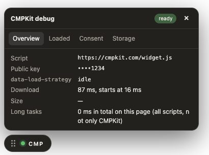

# nuxt-cmpkit-debug

[](https://www.npmjs.com/package/nuxt-cmpkit-debug)
[](https://github.com/kendrick-k/nuxt-cmpkit-debug/actions/workflows/ci.yml)
[](https://github.com/kendrick-k/nuxt-cmpkit-debug/blob/main/LICENSE)
[](https://nuxt.com)

A development-only debug panel for the [CMPKit](https://cmpkit.com) consent widget. A small **CMP** button on the edge of your page opens a panel that shows what is configured, what loads and how fast, the consent state, and the cookies and storage in use.



- **Overview:** the widget script tag, the public key (last 4 characters only), its `data-*` options, download time, size and main-thread long tasks. Warnings for a missing script, an empty key, a script loaded twice, or a widget that is not ready.
- **Loaded:** every third-party origin the page requests, with request count, size and when it started. Useful to check what runs before the visitor chooses.
- **Consent:** the current consent state per category, plus buttons to open the settings, show the banner again or reset the stored choice, and a log of the changes since the page loaded.
- **Storage:** the cookies set by CMPKit, the other cookies (names only) and the `localStorage` keys, with two buttons: **Reset CMPKit cookies** and **Reset all cookies** (a second click within 4 seconds confirms, no browser dialog). On localhost, "all cookies" also signs you out of your other local apps.
- **Status dot at a glance:** a dot next to CMP is green when the setup is healthy, yellow when there are only notices (for example other cookies), and red when something is broken (no script, empty key, script loaded twice, widget not ready).
- **Movable:** drag the handle on the left of the button (or focus it and use the arrow keys, Shift for bigger steps). The CMP part stays a normal button that opens the panel. The position is remembered, and a **Reset position** button appears in the panel.
- **Localhost only.** The panel renders in development on `localhost`, `127.0.0.1` and `*.localhost`. In a production build the component is an empty stub: no panel code is shipped.
- Reads only what the page already has (script tag, Performance API, cookies, `localStorage`, `window.CMPKit`). Nothing is sent anywhere, no telemetry.
- No Tailwind and no other dependency besides Nuxt: the panel brings its own styles.

## Install

```bash
npx nuxt module add nuxt-cmpkit-debug
```

Add the component once, for example in `app.vue`:

```vue
<template>
  <NuxtPage />
  <CmpkitDebug />
</template>
```

It works with the CMPKit script however it is loaded, for example with [`nuxt-cmpkit`](https://github.com/kendrick-k/nuxt-cmpkit) or a plain `<script>` tag.

## Options

```ts
export default defineNuxtConfig({
  modules: ['nuxt-cmpkit-debug'],
  cmpkitDebug: { position: 'left' }, // or 'right'
})
```

| Option | Default | Description |
| --- | --- | --- |
| `position` | `'left'` | Side of the screen where the button sits. |

## Limits

- Sizes are shown as `—` when the browser hides them: cross-origin requests without a `Timing-Allow-Origin` header report no size.
- Long tasks are the total main-thread blocking on the whole page, not only the share caused by CMPKit.
- The consent state comes from the public `window.CMPKit` API: it is empty until the widget is ready and the visitor has chosen.
- "Reset consent" removes the `cmpkit_consent*` entries from `localStorage` and cookies, then reloads the page.

## Development

```bash
npm install
npm run dev:prepare
npm run dev        # playground
npm test
npm run prepack
```

## License

MIT

## More from the same maker

- [CMPKit](https://cmpkit.com): consent management for the sites you ship.
- [nuxt-cmpkit](https://github.com/kendrick-k/nuxt-cmpkit): install the CMPKit widget in a Nuxt app with one public key.
- [nuxt-vitals-panel](https://github.com/kendrick-k/nuxt-vitals-panel): live Core Web Vitals panel for Nuxt.
